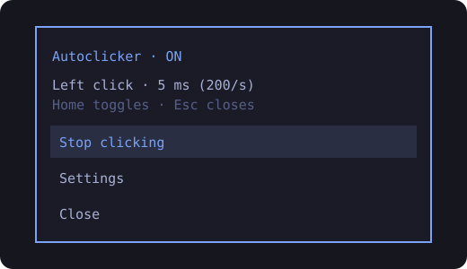

<div align="center">


# Omarchy Autoclicker

**A native Wayland autoclicker for Omarchy / Hyprland. One key, 200 clicks a second, zero root.**

<br />

[](https://github.com/qwerpik/omarchy-autoclicker/actions/workflows/test.yml)
&nbsp;
[](https://wayland.app/protocols/wlr-virtual-pointer-unstable-v1)
&nbsp;
[](#why-its-different)
&nbsp;
[](LICENSE)

---

Home toggles • Rofi menu themed to your Omarchy palette • Live bar widget • Interval 1–60000 ms • Left / right / middle button

[Quickstart](#quickstart) • [Usage](#usage) • [Why it's different](#why-its-different) • [Omarchy setup](docs/OMARCHY.md) • [How it works](docs/HOW-IT-WORKS.md) • [Contributing](CONTRIBUTING.md)

</div>

<br />

<p align="center">
  
</p>

> [!TIP]
> **Try it in 60 seconds**
> ```bash
> git clone https://github.com/qwerpik/omarchy-autoclicker.git
> cd omarchy-autoclicker
> ./install.sh
> autoclicker check     # confirms your compositor supports it — clicks nothing
> autoclicker           # start; run again (or press your key) to stop
> ```

<table>
<tr>
<td width="33%" valign="top">

**⚡ Fast and steady**
A `timerfd` drives exact 50 % press / 50 % release cycles. Measured **200.01 clicks/s** at 5 ms and **50.0/s** at 20 ms.

</td>
<td width="33%" valign="top">

**🔒 No root, no uinput**
Talks to the compositor directly through `wlr-virtual-pointer`. No `ydotool` daemon, no `input` group, no X11.

</td>
<td width="33%" valign="top">

**🎨 Feels native**
Rofi menu in your current Omarchy theme colors, a bar icon that lights up while clicking, ON/OFF notifications.

</td>
</tr>
</table>

## Quickstart

Requirements: a wlroots-style compositor that exposes `zwlr_virtual_pointer_manager_v1` (Hyprland, Sway, river, …), `libwayland-client`, `wayland-scanner`, a C compiler, Python 3.11+, `rofi`, and `notify-send`.

On Arch / Omarchy:

```bash
sudo pacman -S --needed base-devel wayland rofi libnotify
git clone https://github.com/qwerpik/omarchy-autoclicker.git
cd omarchy-autoclicker
./install.sh
```

Then bind a key and add the bar widget — two lines, see [docs/OMARCHY.md](docs/OMARCHY.md).

## Usage

Press **Home** (or whatever you bound) to start clicking at the current mouse position; press it again to stop.

| Command | What it does |
| :--- | :--- |
| `autoclicker` | Toggle clicking |
| `autoclicker menu` | Rofi controls: start/stop and settings |
| `autoclicker start` | Start (no-op if already running) |
| `autoclicker stop` | Stop immediately |
| `autoclicker status` | Print `active` or `inactive` |
| `autoclicker check` | Verify Wayland support without clicking |
| `autoclicker info` | Current settings + state as JSON |

**Settings** (in the menu, saved instantly to `~/.config/autoclicker/settings.json`):

| Setting | Range | Default |
| :--- | :--- | :--- |
| Click interval | 1 – 60000 ms | 5 ms (200 clicks/s) |
| Mouse button | left, right, middle | left |

Opening Settings pauses clicking so you never change it mid-run. **Reset** restores 5 ms / left.

**Bar widget**: the mouse icon is dimmed when off and glows in your theme accent when on. Its tooltip shows button and interval. Click it while idle to open the menu, click it while active to stop, right-click always stops.

## Why it's different

Most Linux autoclickers either need X11 (`xdotool`), or a root-level `uinput` daemon (`ydotool`) that can inject input into *every* session. This one:

- **Uses the compositor's own protocol.** The worker is a ~160-line C program that creates a virtual pointer via [`wlr-virtual-pointer-unstable-v1`](https://wayland.app/protocols/wlr-virtual-pointer-unstable-v1). Only your session, only while it runs.
- **Exists only while clicking.** systemd starts the worker on toggle and stops it on toggle. Nothing runs in the background at login.
- **Never leaves a button stuck.** On `SIGTERM`/`SIGINT` it releases the button, waits for the compositor to receive it, then destroys the device.
- **Doesn't burst after a stall.** Missed timer ticks are skipped instead of replayed.
- **Is race-free.** Rapid key presses are serialised with `flock`; settings are written atomically.

More detail in [docs/HOW-IT-WORKS.md](docs/HOW-IT-WORKS.md).

> [!NOTE]
> Actual delivery depends on system load and on the receiving app — some games cap or debounce input. The numbers above were measured on the reference machine (Ryzen 5 5600X, Hyprland) with a click counter receiving every event.

## Uninstall

```bash
./uninstall.sh            # keeps your settings
./uninstall.sh --purge    # removes ~/.config/autoclicker too
```

Then remove the key binding and the `user.autoclicker` bar entry.

## Contributing

`make check` builds with `-Werror`, runs the tests and `shellcheck`. See [CONTRIBUTING.md](CONTRIBUTING.md).

## License

[MIT](LICENSE). The bundled protocol XML keeps its upstream MIT license.

<div align="center">
<sub>Use responsibly — many online games forbid autoclickers.</sub>
</div>
